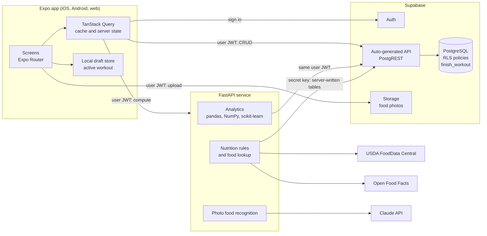
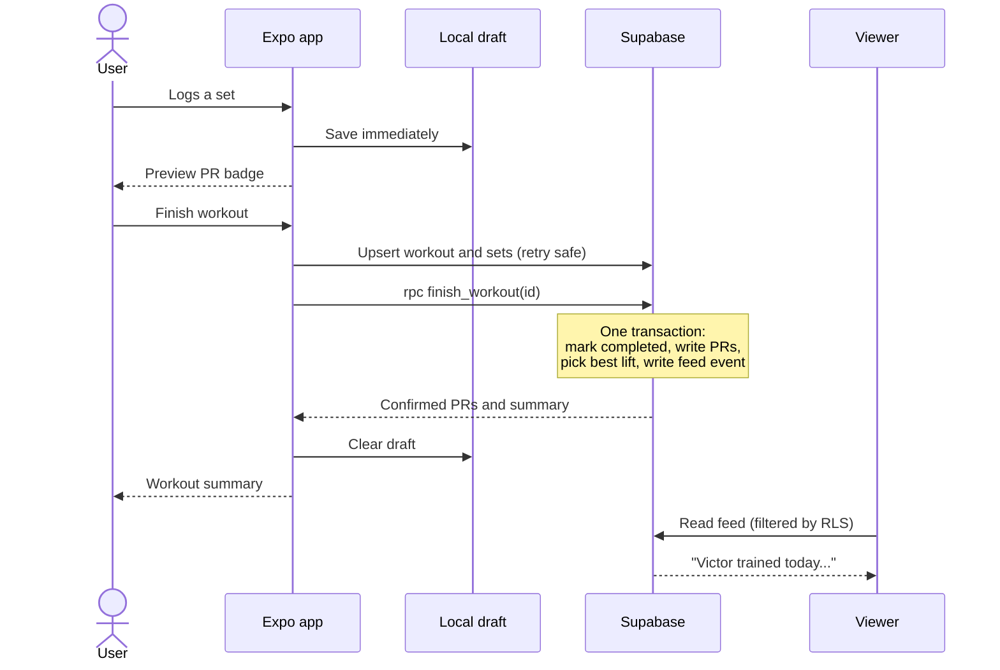
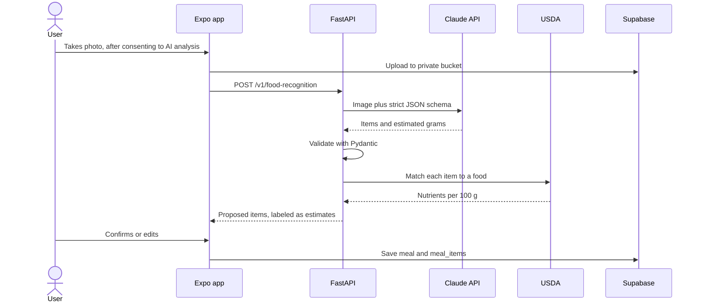

# Architecture

## System overview



## What lives where

| Concern | Lives in | Phase |
|---|---|---|
| Sign-in and sessions | Supabase Auth | MVP |
| Plain CRUD: profile, workouts, sets, body metrics | Client → Supabase | MVP |
| Who can read what | PostgreSQL RLS | MVP |
| e1RM and volume per set | PostgreSQL generated columns | MVP |
| PR detection and feed event | PostgreSQL `finish_workout` | MVP |
| Sharing invites and revocation | PostgreSQL functions | MVP |
| Live PR badge while logging | Client, preview only | MVP |
| Progress analytics | FastAPI | MVP |
| v1 import | Python script | MVP |
| Weak points, weekly review, split suggestions | FastAPI | P2 |
| USDA and Open Food Facts lookup and caching | FastAPI | P2 |
| Meal CRUD | Client → Supabase | P2 |
| AI photo recognition | FastAPI → Claude API | P3 |
| Diet targets and guardrails | FastAPI | P3 |
| Supplement experiment verdicts | FastAPI | P3 |

## Key decisions

### Two backends, split by what the work is

CRUD goes straight from the client to Supabase, and computation goes to FastAPI. Supabase already gives us a
secure API over every table, so routing simple writes through Python would add latency and code with no
benefit. Python earns its place where there is real computation or a secret to protect, and it is also where
your pandas and scikit-learn experience transfers directly.

### Authorization lives only in the database

RLS is the one place that decides who can see what, and FastAPI forwards the user's own JWT when reading data.
If the API had its own permission checks, there would be two systems that could disagree, and one forgotten
`if` would leak health data. With this design, a bug in the API still cannot return rows that the user's token
is not allowed to read.

Sets are the one exception to plain RLS, because a viewer may see a row but not all of its columns. Viewers read them
through the `get_shared_sets` database function, which masks body weight unless they have body access. The rule still
lives in the database, so analytics for a coach reads through that function and needs no permission logic of its own.

### The secret key has a very small job

The Supabase secret key bypasses RLS, so its use is limited to tables clients cannot write: the shared `foods`
cache and server-computed results such as weekly reviews and nutrition targets. The v1 import script is the only
other user. Isolating it in one small module (`app/db/admin.py`) makes that easy to audit. It is never sent to the
client: anything prefixed `EXPO_PUBLIC_` ships inside the app bundle where anyone can read it.

### PR detection runs in the database

`finish_workout` is a PostgreSQL function, so marking the workout finished, writing PRs and creating the feed
event either all happen or none do. Doing this from the client would let anyone forge a PR. Doing it in FastAPI
would make logging depend on a second service being up, and it would need separate handling for partial failure.
The tradeoff is that PL/pgSQL is harder to test than Python, which is why it gets pgTAP tests and stays small.

### One definition per formula

e1RM is defined once, in a generated column. Python reads the stored value rather than recomputing it. The client
needs its own TypeScript copy to show a PR badge instantly, so that copy and the database are tested against a
shared fixture, `fixtures/e1rm_cases.json`. If the two ever drift, a test fails. The server result always wins when
the workout is finished.

### Logging must work without signal

Gyms often have poor reception, and losing a workout would be the fastest way to lose a user's trust. The active
workout is saved to a local store on every change and uploaded when the workout finishes or the connection returns.
Client-generated UUIDs make retries safe, since uploading the same set twice is an upsert. This is deliberately not
full offline-first sync: only the workout in progress is local, which avoids the much harder problem of
conflict resolution across devices.

### Rules first, machine learning where the data supports it

Split suggestions, weak points and verdicts are transparent rules with named thresholds. A single user's dataset is
small: v1 has 16 weeks, which is too little for a model to beat a clear rule, and users deserve to see the reason
behind advice. The v1 regression and clustering code moves to `analytics/` as exploratory features, and a model only
replaces a rule when cross-validation shows it does better.

### AI output is untrusted input

The photo flow treats Claude's response as a proposal rather than a fact, and the database never stores it without
user confirmation. The model is constrained to a strict schema and the response is validated again with Pydantic.
Calories are never taken from the model: it names foods and estimates grams, and nutrition values come from USDA data.
That split matters because a wrong gram estimate is easy for a user to spot and fix, whereas invented macros are not.

## Key flows

### Finishing a workout



### Photo food logging (Phase 3)



## API service

- **Layout:** `app/routers` handles HTTP only. `app/services` handles orchestration. `app/analytics` and
  `app/nutrition` hold pure functions that take and return DataFrames or plain values. Keeping the math free of HTTP
  and database calls is what makes it easy to test.
- **Auth:** every route except `/health` verifies the Supabase JWT against the project's published signing keys.
- **External APIs:** USDA and Open Food Facts results are cached in `foods`, which reduces rate-limit pressure and
  keeps repeat lookups fast. Open Food Facts asks clients to send a descriptive `User-Agent` identifying the app.
- **Model selection:** the Claude model is an environment variable, `ANTHROPIC_MODEL`, chosen when Phase 3 starts.
  Food recognition gets a small labeled set of meal photos so that model changes can be compared on real results.

## Data access for analytics

```python
# Same pattern for every analytics endpoint: fetch under the caller's JWT, then compute purely.
rows = await supabase_as_user(jwt).table("workout_sets").select(...).eq("user_id", target_id).execute()
frame = pd.DataFrame(rows.data)
return weekly_volume_by_muscle(frame)  # A pure function, tested without a database.
```

A user reading their own data uses the table directly, and a viewer goes through `get_shared_sets`, whose masked rows
have nulls that analytics must handle. Reading through PostgREST is slower than a direct SQL connection, but one user's history is small, and it keeps RLS in
force without extra work. If it ever becomes a bottleneck, the fix is a database view or function, and no change to
the authorization model is needed.

## Configuration and secrets

| Variable | Used by | Secret? |
|---|---|---|
| `EXPO_PUBLIC_SUPABASE_URL` | Client | No |
| `EXPO_PUBLIC_SUPABASE_PUBLISHABLE_KEY` | Client | No, RLS is what protects data |
| `EXPO_PUBLIC_API_URL` | Client | No |
| `SUPABASE_URL` | API | No |
| `SUPABASE_PUBLISHABLE_KEY` | API | No |
| `SUPABASE_SECRET_KEY` | API, import script | **Yes** |
| `USDA_API_KEY` | API | **Yes** |
| `ANTHROPIC_API_KEY` | API | **Yes** |
| `ANTHROPIC_MODEL` | API | No |

Real values go in `apps/mobile/.env` and `services/api/.env`, which are gitignored. Each folder has an `.env.example`
documenting the names. Keeping them separate means server secrets never sit in the folder that gets bundled into the
app, and Expo only reads `.env` from its own project folder anyway.

## Testing strategy

| Layer | Tool | What it proves |
|---|---|---|
| Analytics, nutrition and guardrails | pytest | The math is right, including safety limits and sparse-data cases |
| Database | pgTAP | RLS isolates each sharing tier; `finish_workout` is correct and idempotent |
| API | pytest + `httpx` | Auth is required, schemas hold, external services are mocked |
| Client logic | Jest | Unit conversion, PR preview and draft recovery |
| Key screens | React Native Testing Library | Logging flow works and handles being offline |

## Accepted risks

- **Cold starts:** a low-cost API host may sleep when idle. Logging and the feed do not depend on FastAPI, so only
  charts load slowly in that case.
- **Supabase lock-in:** Auth and RLS rely on Supabase conventions. The core is standard PostgreSQL, so migrating is
  work, but the data is never trapped.
- **Open Food Facts quality:** data is crowd-sourced, so items are editable and scanned values can be corrected.
