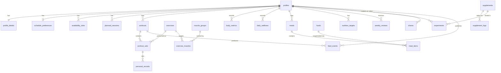

# Data model

PostgreSQL schema for treino-tracker v2, hosted on Supabase. This document is the design source for
the first migrations in `supabase/migrations/`. Every `sql` block below runs top to bottom as one
script.

## Design rules

1. **RLS is row-level, so privacy tiers map to tables.** A policy can hide a row but not a column.
   Anything with a different sensitivity lives in its own table: that is why `profiles` (name,
   avatar) is separate from `profile_details` (birth date, height), and why `body_metrics` is
   separate from `daily_wellness`.
2. **Store kg, remember what the user typed.** `230 lb` becomes `104.326 kg`, and converting back can
   show `229.99`. Sets keep `entered_load` and `entered_unit` for display and `load_kg` for math.
3. **Dates belong to the user's timezone.** An 11 p.m. Sunday session in Orlando is a Monday in UTC.
   `local_date` is written by the client when the row is created, and weekly buckets use it.
4. **The client generates workout and set IDs.** Retrying an upload after a dropped gym connection is
   then an idempotent upsert, not a duplicate.
5. **Derived rows are not writable by clients.** `personal_records` and `feed_events` are written only
   by `SECURITY DEFINER` functions, so nobody can forge a PR or a feed post.

## Entity overview



## Who can see what

| Data | Owner | `workouts` | `workouts_and_body` | `everything` |
|---|---|---|---|---|
| `profiles` (name, avatar, units) | yes | yes | yes | yes |
| `workouts`, `workout_sets`, `personal_records` (completed only) | yes | yes | yes | yes |
| `feed_events` | yes | if event scope is `workouts` | up to `workouts_and_body` | yes |
| `body_metrics` | yes | no | yes | yes |
| `daily_wellness`, `meals`, `meal_items`, `nutrition_targets`, `weekly_reviews`, `supplement_logs`, `experiments` | yes | no | no | yes |
| `profile_details`, `availability_slots`, `schedule_preferences`, `planned_sessions`, `user_sports`, `v1_weekly_aggregates`, food photos | yes | no | no | no |

The last row stays owner-only on purpose, even for `everything`. Birth date is identifying, and a
weekly schedule tells someone where you will be and when.

## Types

```sql
create extension if not exists pg_trgm;

create type public.experience_level as enum ('beginner', 'intermediate', 'advanced');
create type public.goal_type as enum
  ('build_muscle', 'lose_fat', 'strength', 'sport_performance', 'general_health');
create type public.sex_for_calc as enum ('female', 'male', 'unspecified');
create type public.unit_system as enum ('metric', 'imperial');
create type public.load_unit as enum ('kg', 'lb');
create type public.schedule_mode as enum ('fixed', 'flexible', 'custom');
create type public.planned_status as enum ('planned', 'completed', 'missed', 'rescheduled');
create type public.load_type as enum ('external', 'bodyweight');
create type public.muscle_role as enum ('primary', 'secondary');
create type public.movement_pattern as enum ('push', 'pull', 'legs', 'core', 'other');
create type public.workout_type as enum ('strength', 'sport');
create type public.workout_status as enum ('in_progress', 'completed');
create type public.set_type as enum ('warmup', 'working', 'drop', 'failure');
create type public.pr_type as enum ('e1rm', 'load', 'reps_at_load');
create type public.meal_type as enum ('breakfast', 'lunch', 'dinner', 'snack');
create type public.food_source as enum ('usda', 'open_food_facts', 'custom');
create type public.entry_method as enum ('search', 'barcode', 'photo_ai', 'manual');
create type public.experiment_status as enum ('planned', 'running', 'completed', 'abandoned');

-- Declaration order is meaningful: enums compare by position, so
-- `scope >= 'workouts_and_body'` means "at least this much access".
-- Only ever append wider tiers to the end.
create type public.share_scope as enum ('workouts', 'workouts_and_body', 'everything');
create type public.share_status as enum ('pending', 'active', 'revoked');
```

## Tables

### Profiles and availability

Age is derived from `birth_date` because a stored age goes stale, and the under-18 guardrail must
stop applying on the right day. `sex_for_calc` feeds the BMR formula in Phase 3 and allows
`unspecified` (see `PRODUCT_SPEC.md`, module 7).

```sql
create table public.profiles (
  id            uuid primary key references auth.users (id) on delete cascade,
  display_name  text not null check (char_length(display_name) between 1 and 60),
  avatar_path   text,
  unit_system   public.unit_system not null default 'imperial',
  locale        text not null default 'en' check (locale in ('en', 'pt-BR')),
  timezone      text not null default 'UTC',
  onboarded_at  timestamptz,
  created_at    timestamptz not null default now(),
  updated_at    timestamptz not null default now()
);

create table public.profile_details (
  user_id                uuid primary key references public.profiles (id) on delete cascade,
  birth_date             date not null,
  sex_for_calc           public.sex_for_calc not null default 'unspecified',
  height_cm              numeric(5, 2) not null check (height_cm between 50 and 272),
  experience_level       public.experience_level not null,
  goal                   public.goal_type not null,
  equipment_access       text[] not null default '{}',
  target_sessions_per_week smallint not null check (target_sessions_per_week between 1 and 14),
  updated_at             timestamptz not null default now()
);

create table public.sports (
  id    text primary key,
  name  text not null
);

create table public.user_sports (
  user_id   uuid not null references public.profiles (id) on delete cascade,
  sport_id  text not null references public.sports (id),
  primary key (user_id, sport_id)
);
create index user_sports_sport_idx on public.user_sports (sport_id);

create table public.schedule_preferences (
  user_id            uuid primary key references public.profiles (id) on delete cascade,
  mode               public.schedule_mode not null,
  sessions_per_week  smallint check (sessions_per_week between 1 and 14),
  updated_at         timestamptz not null default now(),
  check (mode <> 'flexible' or sessions_per_week is not null)
);

create table public.availability_slots (
  id          uuid primary key default gen_random_uuid(),
  user_id     uuid not null references public.profiles (id) on delete cascade,
  weekday     smallint not null check (weekday between 1 and 7), -- ISO: 1 = Monday
  start_time  time not null,
  end_time    time not null,
  check (end_time > start_time)
);
create index availability_slots_user_idx on public.availability_slots (user_id, weekday);
```

### Exercises

`owner_id is null` marks a catalog exercise, and catalog names are translated in the client through
`slug`. `share` on `exercise_muscles` is the fraction of a set credited to that muscle, so a bench
press can count as 1.0 chest and 0.5 triceps in weekly volume.

```sql
create table public.muscle_groups (
  id    text primary key,
  name  text not null
);

create table public.exercises (
  id                uuid primary key default gen_random_uuid(),
  owner_id          uuid references public.profiles (id) on delete cascade,
  slug              text unique,
  name              text not null,
  equipment         text not null default 'other',
  pattern           public.movement_pattern not null default 'other',
  load_type         public.load_type not null default 'external',
  is_unilateral     boolean not null default false,
  created_at        timestamptz not null default now(),
  unique nulls not distinct (owner_id, name),
  check (owner_id is not null or slug is not null)
);
create index exercises_owner_idx on public.exercises (owner_id) where owner_id is not null;

create table public.exercise_muscles (
  exercise_id      uuid not null references public.exercises (id) on delete cascade,
  muscle_group_id  text not null references public.muscle_groups (id),
  role             public.muscle_role not null default 'primary',
  share            numeric(3, 2) not null default 1.0 check (share > 0 and share <= 1),
  primary key (exercise_id, muscle_group_id)
);
create index exercise_muscles_muscle_idx on public.exercise_muscles (muscle_group_id);
```

### Workouts and sets

The rules for load, volume and e1RM live in generated columns, so SQL, the API and the import script
all read one definition:

- **Effective load** is `load_kg + bodyweight_kg`. For a pull-up, `load_kg` is the added weight and
  `bodyweight_kg` is a snapshot taken at logging time.
- **Volume** is `reps × effective load`, doubled when `is_per_side` is true, because both sides did
  the work. v1 did not double, which matters for the import check below.
- **e1RM** uses Epley, `load × (1 + reps / 30)`. A single rep is the load itself, because plain Epley
  would claim 100 kg × 1 means a 103 kg max. Above 12 reps the estimate is unreliable, and warm-ups
  are not maximal effort, so both produce `null`.

`user_id` is repeated on `workout_sets` so RLS and per-user queries avoid a join. The composite
foreign key guarantees it can never disagree with the parent workout.

Foreign keys to a user's own custom rows are `deferrable initially deferred`. Deleting an account
cascades through several tables, and an immediate check fails if `exercises` is reached before the
`workout_sets` that use it. Deferring moves the check to commit, when those sets are gone. Deleting one
custom exercise that is still in use is still rejected, because the sets remain at commit.

```sql
create table public.planned_sessions (
  id                uuid primary key default gen_random_uuid(),
  user_id           uuid not null references public.profiles (id) on delete cascade,
  planned_date      date not null,
  label             text not null,
  focus             text[] not null default '{}',
  status            public.planned_status not null default 'planned',
  rescheduled_from  uuid references public.planned_sessions (id) on delete set null,
  created_at        timestamptz not null default now()
);
create index planned_sessions_user_date_idx on public.planned_sessions (user_id, planned_date);
create index planned_sessions_rescheduled_idx on public.planned_sessions (rescheduled_from)
  where rescheduled_from is not null;

create table public.workouts (
  id                  uuid primary key,  -- client-generated
  user_id             uuid not null references public.profiles (id) on delete cascade,
  type                public.workout_type not null default 'strength',
  sport_id            text references public.sports (id),
  name                text,
  status              public.workout_status not null default 'in_progress',
  local_date          date not null,
  started_at          timestamptz not null,
  ended_at            timestamptz,
  session_rpe         numeric(3, 1) check (session_rpe between 1 and 10),
  planned_session_id  uuid references public.planned_sessions (id) on delete set null,
  notes               text,
  source              text not null default 'app' check (source in ('app', 'v1_import')),
  source_ref          text,
  created_at          timestamptz not null default now(),
  updated_at          timestamptz not null default now(),
  unique (id, user_id),
  check (ended_at is null or ended_at >= started_at),
  check ((type = 'sport') = (sport_id is not null))
);
create index workouts_user_date_idx on public.workouts (user_id, local_date desc);
create index workouts_sport_idx on public.workouts (sport_id) where sport_id is not null;
create index workouts_planned_idx on public.workouts (planned_session_id)
  where planned_session_id is not null;
create unique index workouts_source_ref_uq on public.workouts (user_id, source, source_ref)
  where source_ref is not null;

create table public.workout_sets (
  id              uuid primary key,  -- client-generated
  workout_id      uuid not null,
  user_id         uuid not null,
  exercise_id     uuid not null references public.exercises (id) deferrable initially deferred,
  exercise_order  smallint not null check (exercise_order >= 0),
  set_number      smallint not null check (set_number >= 1),
  set_type        public.set_type not null default 'working',
  reps            smallint not null check (reps between 0 and 200),
  load_kg         numeric(7, 3) not null default 0 check (load_kg >= 0),
  bodyweight_kg   numeric(6, 3) check (bodyweight_kg > 0),
  entered_load    numeric(7, 2),
  entered_unit    public.load_unit,
  is_per_side     boolean not null default false,
  rpe             numeric(3, 1) check (rpe between 1 and 10),
  completed_at    timestamptz,
  created_at      timestamptz not null default now(),
  updated_at      timestamptz not null default now(),

  effective_load_kg numeric(8, 3) generated always as
    (load_kg + coalesce(bodyweight_kg, 0)) stored,
  volume_kg numeric(10, 3) generated always as
    (reps * (load_kg + coalesce(bodyweight_kg, 0)) * case when is_per_side then 2 else 1 end) stored,
  e1rm_kg numeric(8, 3) generated always as (
    case
      when set_type = 'warmup' or (load_kg + coalesce(bodyweight_kg, 0)) <= 0 then null
      when reps = 1 then load_kg + coalesce(bodyweight_kg, 0)
      when reps between 2 and 12
        then round((load_kg + coalesce(bodyweight_kg, 0)) * (1 + reps / 30.0), 3)
      else null
    end
  ) stored,

  foreign key (workout_id, user_id) references public.workouts (id, user_id) on delete cascade,
  unique (workout_id, exercise_order, set_number),
  check ((entered_load is null) = (entered_unit is null))
);
create index workout_sets_user_exercise_idx
  on public.workout_sets (user_id, exercise_id, e1rm_kg desc nulls last);
create index workout_sets_exercise_idx on public.workout_sets (exercise_id);

create table public.personal_records (
  id              uuid primary key default gen_random_uuid(),
  user_id         uuid not null references public.profiles (id) on delete cascade,
  exercise_id     uuid not null references public.exercises (id) deferrable initially deferred,
  set_id          uuid not null references public.workout_sets (id) on delete cascade,
  workout_id      uuid not null references public.workouts (id) on delete cascade,
  type            public.pr_type not null,
  value           numeric(10, 3) not null,
  previous_value  numeric(10, 3),
  local_date      date not null,
  created_at      timestamptz not null default now(),
  unique (set_id, type)
);
create index personal_records_user_exercise_idx
  on public.personal_records (user_id, exercise_id, type, local_date desc);
create index personal_records_workout_idx on public.personal_records (workout_id);
create index personal_records_exercise_idx on public.personal_records (exercise_id);
```

### Body and wellness

These are separate tables because sharing differs: `workouts_and_body` covers weight but not sleep.

```sql
create table public.body_metrics (
  id            uuid primary key default gen_random_uuid(),
  user_id       uuid not null references public.profiles (id) on delete cascade,
  measured_on   date not null,
  weight_kg     numeric(6, 3) not null check (weight_kg between 20 and 500),
  body_fat_pct  numeric(4, 1) check (body_fat_pct between 1 and 75),
  entered_weight numeric(6, 2),
  entered_unit  public.load_unit,
  source        text not null default 'app' check (source in ('app', 'v1_import')),
  created_at    timestamptz not null default now(),
  unique (user_id, measured_on)
);

create table public.daily_wellness (
  user_id      uuid not null references public.profiles (id) on delete cascade,
  local_date   date not null,
  sleep_hours  numeric(3, 1) check (sleep_hours between 0 and 24),
  water_liters numeric(4, 2) check (water_liters >= 0),
  created_at   timestamptz not null default now(),
  primary key (user_id, local_date)
);

-- Kept exactly as v1 reported it, including nulls. Never recomputed.
create table public.v1_weekly_aggregates (
  user_id              uuid not null references public.profiles (id) on delete cascade,
  week                 smallint not null,
  total_sets           integer,
  total_volume_lb      numeric(10, 2),
  avg_sleep_hours      numeric(4, 2),
  avg_water_liters     numeric(4, 2),
  avg_rpe              numeric(3, 1),
  avg_calories         numeric(6, 1),
  avg_protein_g        numeric(5, 1),
  avg_body_weight_lbs  numeric(5, 1),
  avg_creatine_g       numeric(4, 1),
  primary key (user_id, week)
);
```

### Nutrition

`foods` is a shared cache of external data and has one writer per row kind: the API (with the secret
key) adds USDA and Open Food Facts rows, and users can only add `custom` rows. Otherwise anyone could
poison the shared cache with a fake "0 kcal" entry.

`meal_items` snapshots the food's name and macros so that later edits or cache refreshes never rewrite
what you ate last month. It also records the original AI estimate next to the final value, so every AI
item stays labeled and we can measure how often users correct the model.

```sql
create table public.foods (
  id                 uuid primary key default gen_random_uuid(),
  source             public.food_source not null,
  source_id          text,
  owner_id           uuid references public.profiles (id) on delete cascade,
  name               text not null,
  brand              text,
  barcode            text,
  kcal_per_100g      numeric(6, 1) not null check (kcal_per_100g >= 0),
  protein_per_100g   numeric(5, 2) not null check (protein_per_100g >= 0),
  carbs_per_100g     numeric(5, 2) not null check (carbs_per_100g >= 0),
  fat_per_100g       numeric(5, 2) not null check (fat_per_100g >= 0),
  created_at         timestamptz not null default now(),
  updated_at         timestamptz not null default now(),
  unique (source, source_id),
  check ((source = 'custom') = (owner_id is not null)),
  check (source = 'custom' or source_id is not null)
);
create index foods_barcode_idx on public.foods (barcode) where barcode is not null;
create index foods_name_trgm_idx on public.foods using gin (name gin_trgm_ops);
create index foods_owner_idx on public.foods (owner_id) where owner_id is not null;

create table public.meals (
  id          uuid primary key,  -- client-generated
  user_id     uuid not null references public.profiles (id) on delete cascade,
  local_date  date not null,
  eaten_at    timestamptz not null,
  meal_type   public.meal_type not null,
  photo_path  text,
  notes       text,
  created_at  timestamptz not null default now(),
  updated_at  timestamptz not null default now(),
  unique (id, user_id)
);
create index meals_user_date_idx on public.meals (user_id, local_date desc);

create table public.meal_items (
  id              uuid primary key,  -- client-generated
  meal_id         uuid not null,
  user_id         uuid not null,
  food_id         uuid references public.foods (id) on delete set null,
  food_name       text not null,
  grams           numeric(7, 2) not null check (grams > 0),
  kcal            numeric(7, 1) not null check (kcal >= 0),
  protein_g       numeric(6, 2) not null check (protein_g >= 0),
  carbs_g         numeric(6, 2) not null check (carbs_g >= 0),
  fat_g           numeric(6, 2) not null check (fat_g >= 0),
  entry_method    public.entry_method not null,
  ai_food_label   text,
  ai_grams        numeric(7, 2),
  created_at      timestamptz not null default now(),
  foreign key (meal_id, user_id) references public.meals (id, user_id) on delete cascade,
  check ((entry_method = 'photo_ai') = (ai_grams is not null))
);
create index meal_items_meal_idx on public.meal_items (meal_id);
create index meal_items_food_idx on public.meal_items (food_id) where food_id is not null;

create table public.nutrition_targets (
  id              uuid primary key default gen_random_uuid(),
  user_id         uuid not null references public.profiles (id) on delete cascade,
  effective_from  date not null,
  kcal            integer not null check (kcal > 0),
  protein_g       integer not null check (protein_g >= 0),
  carbs_g         integer not null check (carbs_g >= 0),
  fat_g           integer not null check (fat_g >= 0),
  estimated_tdee  integer,
  floor_applied   boolean not null default false,
  rationale       jsonb not null default '{}',
  created_at      timestamptz not null default now(),
  unique (user_id, effective_from)
);

create table public.weekly_reviews (
  id           uuid primary key default gen_random_uuid(),
  user_id      uuid not null references public.profiles (id) on delete cascade,
  week_start   date not null,
  payload      jsonb not null,
  created_at   timestamptz not null default now(),
  unique (user_id, week_start)
);
```

### Supplements and experiments

A missing `supplement_logs` row means **unknown**, not "did not take it". That distinction keeps a
baseline honest, and it is why v1's weeks without creatine data cannot serve as a baseline.

```sql
create table public.supplements (
  id          uuid primary key default gen_random_uuid(),
  owner_id    uuid references public.profiles (id) on delete cascade,
  name        text not null,
  default_dose numeric(7, 2),
  dose_unit   text not null default 'g',
  unique nulls not distinct (owner_id, name)
);
create index supplements_owner_idx on public.supplements (owner_id) where owner_id is not null;

create table public.supplement_logs (
  id             uuid primary key default gen_random_uuid(),
  user_id        uuid not null references public.profiles (id) on delete cascade,
  supplement_id  uuid not null references public.supplements (id) on delete cascade,
  taken_on       date not null,
  dose           numeric(7, 2) not null check (dose >= 0),
  dose_unit      text not null default 'g',
  unique (user_id, supplement_id, taken_on)
);
create index supplement_logs_supplement_idx on public.supplement_logs (supplement_id);

create table public.experiments (
  id                  uuid primary key default gen_random_uuid(),
  user_id             uuid not null references public.profiles (id) on delete cascade,
  supplement_id       uuid not null references public.supplements (id) deferrable initially deferred,
  dose                numeric(7, 2) not null check (dose > 0),
  dose_unit           text not null default 'g',
  baseline_start      date not null,
  baseline_end        date not null,
  start_date          date not null,
  end_date            date,
  metrics             text[] not null
    check (metrics <@ array['anchor_e1rm', 'volume', 'body_weight']
           and cardinality(metrics) > 0),
  anchor_exercise_id  uuid references public.exercises (id) deferrable initially deferred,
  status              public.experiment_status not null default 'planned',
  result              jsonb,
  created_at          timestamptz not null default now(),
  check (baseline_start < baseline_end),
  check (baseline_end < start_date),
  check (end_date is null or end_date > start_date),
  check (not (metrics @> array['anchor_e1rm']) or anchor_exercise_id is not null)
);
create index experiments_user_idx on public.experiments (user_id, start_date desc);
create index experiments_supplement_idx on public.experiments (supplement_id);
create index experiments_anchor_idx on public.experiments (anchor_exercise_id)
  where anchor_exercise_id is not null;
```

### Sharing and feed

`required_scope` on `feed_events` is the minimum access needed to see that event. Whoever writes an
event must keep the payload within that scope, so a `workouts` event can name a lift but must never
mention body weight.

```sql
create table public.shares (
  id                 uuid primary key default gen_random_uuid(),
  owner_id           uuid not null references public.profiles (id) on delete cascade,
  viewer_id          uuid references public.profiles (id) on delete cascade,
  scope              public.share_scope not null,
  status             public.share_status not null default 'pending',
  invite_token_hash  text unique,
  invite_expires_at  timestamptz,
  created_at         timestamptz not null default now(),
  accepted_at        timestamptz,
  revoked_at         timestamptz,
  check (owner_id <> viewer_id),
  check (status <> 'active' or viewer_id is not null)
);
create unique index shares_active_pair_uq on public.shares (owner_id, viewer_id)
  where status = 'active';
create index shares_viewer_idx on public.shares (viewer_id, owner_id) where status = 'active';

create table public.feed_events (
  id              uuid primary key default gen_random_uuid(),
  actor_id        uuid not null references public.profiles (id) on delete cascade,
  type            text not null check (type in ('trained_today')),
  workout_id      uuid references public.workouts (id) on delete cascade,
  required_scope  public.share_scope not null default 'workouts',
  payload         jsonb not null,
  local_date      date not null,
  created_at      timestamptz not null default now(),
  unique (workout_id, type)
);
create index feed_events_actor_idx on public.feed_events (actor_id, created_at desc);
```

## Triggers

`handle_new_user` creates the profile when Supabase Auth creates a user. It runs in the auth
transaction, so an account can never exist without a profile.

```sql
create function public.set_updated_at() returns trigger
language plpgsql set search_path = '' as $$
begin
  new.updated_at = now();
  return new;
end $$;

create trigger profiles_updated before update on public.profiles
  for each row execute function public.set_updated_at();
create trigger profile_details_updated before update on public.profile_details
  for each row execute function public.set_updated_at();
create trigger schedule_preferences_updated before update on public.schedule_preferences
  for each row execute function public.set_updated_at();
create trigger workouts_updated before update on public.workouts
  for each row execute function public.set_updated_at();
create trigger workout_sets_updated before update on public.workout_sets
  for each row execute function public.set_updated_at();
create trigger foods_updated before update on public.foods
  for each row execute function public.set_updated_at();
create trigger meals_updated before update on public.meals
  for each row execute function public.set_updated_at();

create function public.handle_new_user() returns trigger
language plpgsql security definer set search_path = '' as $$
begin
  insert into public.profiles (id, display_name)
  values (new.id, coalesce(nullif(new.raw_user_meta_data ->> 'display_name', ''), 'Athlete'));
  return new;
end $$;

create trigger on_auth_user_created after insert on auth.users
  for each row execute function public.handle_new_user();

revoke all on function public.handle_new_user() from public, anon, authenticated;
```

## Permission functions

Policies call `can_view`. It is `SECURITY DEFINER` so that checking access does not itself run RLS on
`shares`, which is both faster and free of policy recursion. Every definer function pins an empty
`search_path` and qualifies each name, which stops a caller from hijacking it with a same-named object.

Clients get read-only access to `shares`; all changes go through the functions below. A plain `UPDATE`
policy could not stop an owner from naming a viewer who never agreed, or from reviving a revoked share.
Invite tokens are stored only as a SHA-256 hash, so a database leak does not expose usable invites.

```sql
create function public.can_view(p_owner uuid, p_required public.share_scope)
returns boolean
language sql stable security definer set search_path = '' as $$
  select p_owner = auth.uid() or exists (
    select 1 from public.shares s
    where s.owner_id = p_owner
      and s.viewer_id = auth.uid()
      and s.status = 'active'
      and s.scope >= p_required
  );
$$;

-- True when the two users share in either direction. Lets each side see the other's name.
create function public.is_connected(p_other uuid)
returns boolean
language sql stable security definer set search_path = '' as $$
  select exists (
    select 1 from public.shares s
    where s.status = 'active'
      and ((s.owner_id = p_other and s.viewer_id = auth.uid())
        or (s.owner_id = auth.uid() and s.viewer_id = p_other))
  );
$$;

-- Returns the raw token exactly once. Only its hash is stored.
create function public.create_share_invite(p_scope public.share_scope)
returns text
language plpgsql security definer set search_path = '' as $$
declare
  v_token text := replace(gen_random_uuid()::text || gen_random_uuid()::text, '-', '');
begin
  if auth.uid() is null then
    raise exception 'not authenticated' using errcode = '28000';
  end if;
  insert into public.shares (owner_id, scope, invite_token_hash, invite_expires_at)
  values (auth.uid(), p_scope,
          encode(sha256(convert_to(v_token, 'UTF8')), 'hex'),
          now() + interval '7 days');
  return v_token;
end $$;

create function public.accept_share(p_token text)
returns uuid
language plpgsql security definer set search_path = '' as $$
declare
  v_id uuid;
begin
  if auth.uid() is null then
    raise exception 'not authenticated' using errcode = '28000';
  end if;
  update public.shares
     set viewer_id = auth.uid(), status = 'active', accepted_at = now(),
         invite_token_hash = null, invite_expires_at = null
   where invite_token_hash = encode(sha256(convert_to(p_token, 'UTF8')), 'hex')
     and status = 'pending'
     and invite_expires_at > now()
     and owner_id <> auth.uid()
  returning id into v_id;
  if v_id is null then
    raise exception 'invalid or expired invite' using errcode = 'P0002';
  end if;
  return v_id;
end $$;

-- Only the owner can change how much is shared.
create function public.update_share_scope(p_share_id uuid, p_scope public.share_scope)
returns void
language plpgsql security definer set search_path = '' as $$
begin
  update public.shares set scope = p_scope
   where id = p_share_id and owner_id = auth.uid() and status in ('pending', 'active');
  if not found then
    raise exception 'share not found' using errcode = 'P0002';
  end if;
end $$;

-- Either side can end a share, and it takes effect on the next query.
create function public.revoke_share(p_share_id uuid)
returns void
language plpgsql security definer set search_path = '' as $$
begin
  update public.shares
     set status = 'revoked', revoked_at = now(),
         invite_token_hash = null, invite_expires_at = null
   where id = p_share_id
     and (owner_id = auth.uid() or viewer_id = auth.uid())
     and status <> 'revoked';
  if not found then
    raise exception 'share not found' using errcode = 'P0002';
  end if;
end $$;

-- Supabase grants EXECUTE to anon by default, so every function is locked down explicitly.
revoke all on function public.can_view(uuid, public.share_scope) from public, anon;
revoke all on function public.is_connected(uuid) from public, anon;
revoke all on function public.create_share_invite(public.share_scope) from public, anon;
revoke all on function public.accept_share(text) from public, anon;
revoke all on function public.update_share_scope(uuid, public.share_scope) from public, anon;
revoke all on function public.revoke_share(uuid) from public, anon;
grant execute on function public.can_view(uuid, public.share_scope) to authenticated;
grant execute on function public.is_connected(uuid) to authenticated;
grant execute on function public.create_share_invite(public.share_scope) to authenticated;
grant execute on function public.accept_share(text) to authenticated;
grant execute on function public.update_share_scope(uuid, public.share_scope) to authenticated;
grant execute on function public.revoke_share(uuid) to authenticated;
```

## Row Level Security

Every table has RLS on, and no policy means no access. All policies target `authenticated`, so `anon`
can read nothing. `(select auth.uid())` is deliberate: Postgres evaluates it once per query rather
than once per row, which matters on tables the size of `workout_sets`.

The common shape is one policy giving the owner full access, plus a second read-only policy for
viewers. Permissive policies combine with OR.

Foreign key checks ignore RLS, so a policy has to stop users from referencing rows that aren't theirs.
Viewers can legitimately read the IDs of the owner's custom exercises. Without the extra `with check`
on `workout_sets`, `supplement_logs` and `experiments`, a viewer could point their own rows at those
IDs and permanently block the owner from deleting that exercise or their account.

```sql
-- Enable RLS everywhere.
alter table public.profiles enable row level security;
alter table public.profile_details enable row level security;
alter table public.sports enable row level security;
alter table public.user_sports enable row level security;
alter table public.schedule_preferences enable row level security;
alter table public.availability_slots enable row level security;
alter table public.muscle_groups enable row level security;
alter table public.exercises enable row level security;
alter table public.exercise_muscles enable row level security;
alter table public.planned_sessions enable row level security;
alter table public.workouts enable row level security;
alter table public.workout_sets enable row level security;
alter table public.personal_records enable row level security;
alter table public.body_metrics enable row level security;
alter table public.daily_wellness enable row level security;
alter table public.v1_weekly_aggregates enable row level security;
alter table public.foods enable row level security;
alter table public.meals enable row level security;
alter table public.meal_items enable row level security;
alter table public.nutrition_targets enable row level security;
alter table public.weekly_reviews enable row level security;
alter table public.supplements enable row level security;
alter table public.supplement_logs enable row level security;
alter table public.experiments enable row level security;
alter table public.shares enable row level security;
alter table public.feed_events enable row level security;

-- Profiles: the owner, plus anyone connected through an active share. No INSERT or DELETE:
-- the auth trigger creates the row and deleting the auth user cascades.
create policy profiles_select on public.profiles for select to authenticated
  using (id = (select auth.uid()) or public.is_connected(id));
create policy profiles_update on public.profiles for update to authenticated
  using (id = (select auth.uid())) with check (id = (select auth.uid()));

-- Owner-only tables.
create policy profile_details_owner on public.profile_details for all to authenticated
  using (user_id = (select auth.uid())) with check (user_id = (select auth.uid()));
create policy user_sports_owner on public.user_sports for all to authenticated
  using (user_id = (select auth.uid())) with check (user_id = (select auth.uid()));
create policy schedule_preferences_owner on public.schedule_preferences for all to authenticated
  using (user_id = (select auth.uid())) with check (user_id = (select auth.uid()));
create policy availability_slots_owner on public.availability_slots for all to authenticated
  using (user_id = (select auth.uid())) with check (user_id = (select auth.uid()));
create policy planned_sessions_owner on public.planned_sessions for all to authenticated
  using (user_id = (select auth.uid())) with check (user_id = (select auth.uid()));
create policy v1_weekly_aggregates_select on public.v1_weekly_aggregates for select to authenticated
  using (user_id = (select auth.uid()));

-- Read-only catalogs. Seeded by migrations.
create policy sports_read on public.sports for select to authenticated using (true);
create policy muscle_groups_read on public.muscle_groups for select to authenticated using (true);

-- Exercises: catalog for everyone, custom for the owner and their workout viewers.
create policy exercises_select on public.exercises for select to authenticated
  using (owner_id is null or public.can_view(owner_id, 'workouts'));
create policy exercises_insert on public.exercises for insert to authenticated
  with check (owner_id = (select auth.uid()));
create policy exercises_update on public.exercises for update to authenticated
  using (owner_id = (select auth.uid())) with check (owner_id = (select auth.uid()));
create policy exercises_delete on public.exercises for delete to authenticated
  using (owner_id = (select auth.uid()));

create policy exercise_muscles_select on public.exercise_muscles for select to authenticated
  using (exists (select 1 from public.exercises e where e.id = exercise_id));
create policy exercise_muscles_write on public.exercise_muscles for all to authenticated
  using (exists (select 1 from public.exercises e
                 where e.id = exercise_id and e.owner_id = (select auth.uid())))
  with check (exists (select 1 from public.exercises e
                      where e.id = exercise_id and e.owner_id = (select auth.uid())));

-- Workouts: viewers never see a session that is still in progress.
create policy workouts_owner on public.workouts for all to authenticated
  using (user_id = (select auth.uid())) with check (user_id = (select auth.uid()));
create policy workouts_viewer on public.workouts for select to authenticated
  using (status = 'completed' and public.can_view(user_id, 'workouts'));

create policy workout_sets_owner on public.workout_sets for all to authenticated
  using (user_id = (select auth.uid()))
  with check (user_id = (select auth.uid()) and exists (
    select 1 from public.exercises e
    where e.id = exercise_id and (e.owner_id is null or e.owner_id = (select auth.uid()))));
create policy workout_sets_viewer on public.workout_sets for select to authenticated
  using (public.can_view(user_id, 'workouts') and exists (
    select 1 from public.workouts w where w.id = workout_id and w.status = 'completed'));

-- Personal records: read-only for clients. Written by finish_workout.
create policy personal_records_select on public.personal_records for select to authenticated
  using (public.can_view(user_id, 'workouts'));

-- Body metrics: needs at least workouts_and_body.
create policy body_metrics_owner on public.body_metrics for all to authenticated
  using (user_id = (select auth.uid())) with check (user_id = (select auth.uid()));
create policy body_metrics_viewer on public.body_metrics for select to authenticated
  using (public.can_view(user_id, 'workouts_and_body'));

-- The "everything" tier.
create policy daily_wellness_owner on public.daily_wellness for all to authenticated
  using (user_id = (select auth.uid())) with check (user_id = (select auth.uid()));
create policy daily_wellness_viewer on public.daily_wellness for select to authenticated
  using (public.can_view(user_id, 'everything'));

create policy meals_owner on public.meals for all to authenticated
  using (user_id = (select auth.uid())) with check (user_id = (select auth.uid()));
create policy meals_viewer on public.meals for select to authenticated
  using (public.can_view(user_id, 'everything'));
create policy meal_items_owner on public.meal_items for all to authenticated
  using (user_id = (select auth.uid())) with check (user_id = (select auth.uid()));
create policy meal_items_viewer on public.meal_items for select to authenticated
  using (public.can_view(user_id, 'everything'));

create policy supplement_logs_owner on public.supplement_logs for all to authenticated
  using (user_id = (select auth.uid()))
  with check (user_id = (select auth.uid()) and exists (
    select 1 from public.supplements s
    where s.id = supplement_id and (s.owner_id is null or s.owner_id = (select auth.uid()))));
create policy supplement_logs_viewer on public.supplement_logs for select to authenticated
  using (public.can_view(user_id, 'everything'));
create policy experiments_owner on public.experiments for all to authenticated
  using (user_id = (select auth.uid()))
  with check (user_id = (select auth.uid())
    and exists (select 1 from public.supplements s
                where s.id = supplement_id and (s.owner_id is null or s.owner_id = (select auth.uid())))
    and (anchor_exercise_id is null or exists (
      select 1 from public.exercises e
      where e.id = anchor_exercise_id and (e.owner_id is null or e.owner_id = (select auth.uid())))));
create policy experiments_viewer on public.experiments for select to authenticated
  using (public.can_view(user_id, 'everything'));

-- Server-computed and read-only for clients; the API writes them on the user's behalf.
create policy nutrition_targets_select on public.nutrition_targets for select to authenticated
  using (public.can_view(user_id, 'everything'));
create policy weekly_reviews_select on public.weekly_reviews for select to authenticated
  using (public.can_view(user_id, 'everything'));

-- Foods: everyone reads the shared cache, but users can write only their own custom foods.
-- Viewers do not need other people's custom foods because meal_items snapshots the name and macros.
create policy foods_select on public.foods for select to authenticated
  using (owner_id is null or owner_id = (select auth.uid()));
create policy foods_insert on public.foods for insert to authenticated
  with check (owner_id = (select auth.uid()) and source = 'custom');
create policy foods_update on public.foods for update to authenticated
  using (owner_id = (select auth.uid()))
  with check (owner_id = (select auth.uid()) and source = 'custom');
create policy foods_delete on public.foods for delete to authenticated
  using (owner_id = (select auth.uid()));

create policy supplements_select on public.supplements for select to authenticated
  using (owner_id is null or public.can_view(owner_id, 'everything'));
create policy supplements_write on public.supplements for all to authenticated
  using (owner_id = (select auth.uid())) with check (owner_id = (select auth.uid()));

-- Sharing: read-only for clients; changes go through the permission functions.
create policy shares_select on public.shares for select to authenticated
  using (owner_id = (select auth.uid()) or viewer_id = (select auth.uid()));

-- Feed: read-only for clients. Written by finish_workout.
create policy feed_events_select on public.feed_events for select to authenticated
  using (public.can_view(actor_id, required_scope));
```

### Storage

Food photos go in a private bucket under `{user_id}/{meal_id}.jpg`. Access is owner-only at every
sharing tier, because a meal photo can reveal far more than the macros do.

```sql
insert into storage.buckets (id, name, public) values ('food-photos', 'food-photos', false);

create policy food_photos_owner on storage.objects for all to authenticated
  using (bucket_id = 'food-photos'
         and (storage.foldername(name))[1] = (select auth.uid())::text)
  with check (bucket_id = 'food-photos'
              and (storage.foldername(name))[1] = (select auth.uid())::text);
```

## `finish_workout`: PRs and the feed event

`finish_workout(p_workout_id uuid)` is the MVP's main database function. It is designed here and written
in the MVP migration. It runs as `SECURITY DEFINER`, must confirm the caller owns the workout, and is
idempotent, so a retry after a dropped connection cannot duplicate anything. In one transaction it:

1. Marks the workout `completed` and sets `ended_at`.
2. Compares each exercise's working sets with that user's **earlier** sets by `local_date`, and writes
   `personal_records` rows. The first time an exercise is logged sets the baseline and is not a PR.
3. Chooses the best lift using the tiers below and writes one `feed_events` row, but only when the user
   has at least one active share.

**Choosing the best lift.** Candidates are compared within a tier by percentage gain, which is what
stops squats from always winning. The first tier with a candidate wins.

| Tier | Condition | Example wording |
|---|---|---|
| 1 | All-time e1RM PR | `Squats 230 lb × 10 (+5 lb PR)` |
| 2 | Rep PR: more reps than ever at this load or higher | `Squats 230 lb × 11 (rep PR)` |
| 3 | Beats the best of the last 8 weeks | `Squats 230 lb × 10 (+5 lb vs recent best)` |
| 4 | Otherwise, the set closest to the all-time best e1RM | `Squats 230 lb × 10 (94% of best)` |

The `+N lb` shows the load increase when the reps match the previous best, and the e1RM gain otherwise.

Tier 3 exists because of real v1 data: squats went from 260 lb in week 1 to 230 lb in week 16, so
calling a return to 230 lb a "PR" would be false. The word "PR" appears only in tier 1.

**After editing history.** Changing or deleting a finished set can invalidate later records, so
`recompute_prs(exercise_id)` rebuilds that exercise's rows from its sets. Deleting a workout cascades to
its records and feed event, then recomputes.

## Importing v1 data

`services/api/scripts/import_v1.py` reads `data/v1/` (gitignored). A profile of the real v1 files found
several things the script has to handle:

| v1 fact | Handling |
|---|---|
| CSVs give a weekday but **no calendar date** | Required flag `--week1-start YYYY-MM-DD`; the script derives each `local_date` |
| 48 exercise names include duplicates: `Squat`/`Squats`, `Pull up`/`Pull-up`, `Single arm row`/`Single-arm row`, and a typo, `reverse pack deck` | Reviewed mapping file `services/api/scripts/v1_exercise_map.csv`. The script stops on any unmapped name instead of guessing |
| Pull-ups are logged at 160 lb, which Victor confirmed was body weight, not added load | Mapping marks them `bodyweight`: `load_kg = 0`, `bodyweight_kg` = the logged value |
| Volume never doubles single-arm lifts, while v2 does | The check below uses v1's formula, not `volume_kg` |
| Week 1 history says `73040` but its CSV sums to `72680` | CSVs are the source for sets, `history.json` is stored as is, and the 360 lb gap is reported |
| Wellness averages start in week 4; body weight and creatine exist only in weeks 15 and 16 | Stored as `null`, never `0`. No retroactive creatine experiment is possible |
| Set-level data is only `sets × reps @ load` | `3x10 @ 160` expands to three identical sets with `rpe = null` |

The script:

- Uses the secret key, targets an explicit `--user-id`, and supports `--dry-run`.
- Is idempotent through `source = 'v1_import'` and `source_ref`, such as `week06-tuesday`.
- Stores one weekly `body_metrics` row on the week's Wednesday where weight exists.
- Runs PR backfill without writing any feed events, so importing history does not notify anyone.
- Finishes by checking each week's sets and volume against the CSV and printing any differences.

## Validation status

The migrations in `supabase/migrations/` are generated from the `sql` blocks above, with two changes for
Supabase: `pg_trgm` is installed in the `extensions` schema, and the first migration also drops the
scaffold `hello()`. They run on the local Supabase stack (PostgreSQL 17), and `supabase/tests/` covers them
with pgTAP. `finish_workout` and `recompute_prs` are designed but not written yet.
